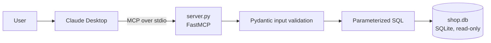

# Shop MCP Server

A read-only Model Context Protocol (MCP) server that lets Claude Desktop
query an e-commerce orders database through four validated tools.

- **Live demo (web form over the same tools):** https://shop-mcp-server123.streamlit.app
- **2-minute demo video (Claude Desktop calling the tools over MCP):** https://drive.google.com/file/d/1-FEu3LyBbifU6kYzxE29Orre33f67cWN/view?usp=drivesdk

## Problem

LLM assistants are useful for answering order questions, but giving a model
raw database access is risky. This server exposes only a small set of
read-only tools, validates every input, and returns clear error messages,
so the model can answer questions about orders without being able to
modify or leak anything it should not.

## Architecture



## Tools

| Tool | Purpose |
|---|---|
| `search_orders` | Filter by delivery status and category, newest first (max 50) |
| `get_order` | Fetch one order by its UUID |
| `get_customer_orders` | List a customer's orders, newest first (max 50) |
| `customer_summary` | Order count, total spent, first and last order date |

## Safety design

- The database is opened in read-only mode (`mode=ro`), so writes fail at the SQLite level.
- All queries are parameterized; user input is never concatenated into SQL.
- Inputs are validated with Pydantic: status and category are fixed value sets, order IDs must match a UUID pattern, customer IDs and limits have numeric ranges.
- Invalid input returns a clear `error` message instead of raising.
- Shipping and billing addresses are never returned by any tool.

## Data

10,000 synthetic orders from the Hugging Face dataset
[`millat/e-commerce-orders`](https://huggingface.co/datasets/millat/e-commerce-orders)
(see the dataset card for its license). It has no customer or product names,
only IDs and categories.

## What the demo video shows

1. `get customer summary for customer 97`
2. `show all orders of customer 97`
3. `find 3 pending Toys orders`
4. `get customer summary for customer -5` (the server rejects the invalid ID)
5. A SQL-injection-style status string (Claude itself refused to forward it, see Limitations)

## Test results

| Set | Cases | Passed |
|---|---|---|
| Dev (used while building) | 15 | 15 |
| Hidden (run once, at the end) | 10 | **10** |

The hidden cases were committed before their first run
(see the commit "Step 4: 10 hidden test cases written before running").
Expected values come from SQL queries on the dataset, not from running the server.

Case mix across both sets: 10 easy, 6 hard, 3 bad input, 3 no data, 3 attack.
Cases are in `tests/dev.jsonl` and `tests/hidden.jsonl`, one JSON object per line:

```json
{"input": {"tool": "customer_summary", "args": {"customer_id": 97}}, "expected": "\"order_count\": 3,", "tag": "easy"}
```

`run_tests.py` passes if the expected text appears in the tool output.

## Run it locally (Windows PowerShell)

```powershell
git clone https://github.com/ztsprofessionalaiid7-alt/shop-mcp-server.git
cd shop-mcp-server
python -m venv .venv
.venv\Scripts\Activate.ps1
pip install -r requirements-dev.txt
```

`shop.db` is already in the repository. To rebuild it from the dataset:

```powershell
python download_data.py
python load_data.py
```

Run the tests and the web demo:

```powershell
python run_tests.py tests\dev.jsonl
python run_tests.py tests\hidden.jsonl
streamlit run app.py
```

### Connect to Claude Desktop

Add this block to `%APPDATA%\Claude\claude_desktop_config.json` (keep any existing keys),
using your own absolute paths, then fully quit and reopen Claude Desktop:

```json
{
  "mcpServers": {
    "shop-server": {
      "command": "C:\\path\\to\\shop-mcp-server\\.venv\\Scripts\\python.exe",
      "args": ["C:\\path\\to\\shop-mcp-server\\server.py"]
    }
  }
}
```

The server uses the MCP Python SDK 1.x (`mcp<2`), because `FastMCP` was renamed in 2.x.

## Project structure

```
server.py            MCP server with the four tools
app.py               Streamlit web form that calls the same tool functions
load_data.py         Builds shop.db from the downloaded dataset
download_data.py     Downloads the dataset from Hugging Face
check_data.py        Prints dataset statistics
run_tests.py         Test runner for the .jsonl case files
peek.py              Runs one read-only SQL query (used to derive expected values)
tests/               dev.jsonl and hidden.jsonl
requirements.txt     Dependencies for the deployed app
requirements-dev.txt Extra dependencies for rebuilding the data
```

## Limitations

- Tests call the Python tool functions directly, not through the MCP protocol. The protocol path is only covered by the manual Claude Desktop demo.
- The Streamlit app is a web form over the same functions. It is not an MCP server reachable over the network.
- In the demo, Claude itself recognised the SQL-injection-style input and did not send it to the tool. The server-side defence is verified by the attack cases in the test sets, not by that demo.
- 10/10 on the hidden set means the server behaves as designed on the cases I wrote. There were no failing cases, and the cases are mostly easy to medium, so it is not proof of robustness. The match check is also lenient (substring of the output).
- Search and customer-order results are capped at 50 rows with no pagination.
- Data is synthetic, with no customer names or product names.
